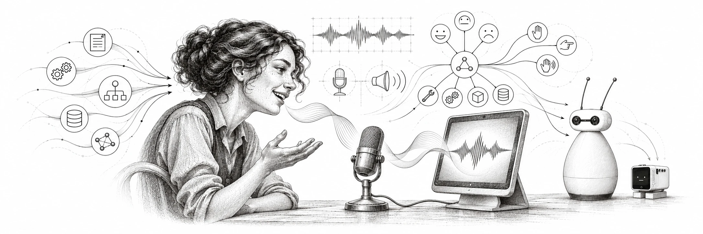

# Forge Conversationalist

**Give an AI agent a voice—and, optionally, a physical presence.**

Forge Conversationalist is a device-independent real-time voice application built on [LiveKit Agents](https://github.com/livekit/agents). Talk with an AI assistant through a browser or local microphone and speakers, choose speech and language-model providers, and connect approved tools when you need them. Conversation works without a robot or local language model.

An optional [Forge Puppeteer](https://github.com/AgenticForge-Labs/forge-puppeteer) connection can bring the same conversation to supported robots. Puppeteer turns semantic cues and explicit gesture requests into device-specific performances; each robot's SDK retains its own hardware controls and safety boundaries.

## What you can do

- **Have a live voice conversation.** Use a browser or local audio devices, with interruption handling and configurable speech providers.
- **Choose a voice and personality.** Configure LiveKit, OpenRouter or hybrid speech profiles and an optional 4G personality. Personality selection does not grant tools or enable a robot.
- **Connect approved MCP tools.** Give the assistant access to an explicitly configured server and tool allowlist, subject to the server's own permissions.
- **Delegate longer work.** Optionally submit and check tasks through a configured Hermes API; task admission is not task completion.
- **Add robot expression.** Optionally connect Puppeteer for listening, speaking, and explicitly requested gestures across supported performers. Available capabilities depend on configuration, authorization and device readiness.

## How it fits together

LiveKit handles rooms and real-time audio. Conversationalist configures the voice agent and optional integrations. MCP servers and Hermes own their tool and task permissions; Puppeteer coordinates robot performance, while robot SDKs own device-level execution. The application can run without the wider AgenticForge platform.

Robot integrations and external services require separate setup. Software tests and simulated behavior do not qualify physical motion. See [Native ensemble deployment](docs/NATIVE_ENSEMBLE.md) and [Puppeteer](https://github.com/AgenticForge-Labs/forge-puppeteer).

## Get started

The worker requires Python 3.11–3.13; the example below uses Python 3.12 and `uv`. A LiveKit service and credentials for the selected providers are needed for a live session.

1. Clone the repository, then copy `.env.example` to `.env.local`:

   ```bash
   git clone https://github.com/AgenticForge-Labs/forge-conversationalist.git
   cd forge-conversationalist
   cp .env.example .env.local
   ```

   Configure `LIVEKIT_URL`, `LIVEKIT_API_KEY`, `LIVEKIT_API_SECRET` and a long random `CONVERSATIONALIST_ACCESS_TOKEN`. Choose a `CONVERSATIONALIST_PRESET` of `livekit`, `openrouter`, or `hybrid`; add `OPENROUTER_API_KEY` to the worker environment when needed.
2. Install and start the worker:

   ```bash
   uv venv --python 3.12
   uv pip install --python .venv/bin/python -e '.[dev]'
   .venv/bin/python -m forge_conversationalist.agent download-files
   .venv/bin/python -m forge_conversationalist.agent dev
   ```

3. In another terminal, copy `web/.env.example` to `web/.env.local`, set its LiveKit and development access-token values, then run:

   ```bash
   cd web
   npm install
   npm run dev
   ```

   Visit [http://localhost:3000](http://localhost:3000). Keep OpenRouter, MCP and Hermes credentials in the trusted worker environment, not in the browser configuration.

Alternatively, run `.venv/bin/forge-conversationalist-audio --list-devices` and then `.venv/bin/forge-conversationalist-audio` to join with local system audio instead of a browser. See [setup and operational details](STATUS.md#archived-readme-development-notes) for the full configuration and device options.

## Use with robots

Puppeteer provides a shared [Model Context Protocol](https://modelcontextprotocol.io/) interface for supported robot capabilities and semantic expressions. Conversationalist is an optional voice client: it does not connect directly to motor drivers or establish hardware authority. Review [native ensemble deployment](docs/NATIVE_ENSEMBLE.md) and the device-specific Puppeteer documentation before enabling any physical performer.

## Project documentation

- [Current status and preserved development history](STATUS.md)
- [Development plan](PLAN.md)
- [Architecture](docs/ARCHITECTURE.md)
- [Presentation signals](docs/PRESENTATION_SIGNALS.md)
- [Fake-only embodiment reference](docs/EMBODIMENT.md)
- [Native ensemble deployment](docs/NATIVE_ENSEMBLE.md)

## Acknowledgments

Thanks to [LiveKit Agents](https://github.com/livekit/agents) for the real-time voice and room foundation, [Pollen Robotics' Reachy Mini Conversation App](https://github.com/pollen-robotics/reachy_mini_conversation_app) for inspiration in expressive voice interaction, and the [Model Context Protocol](https://modelcontextprotocol.io/) community for its standard tool interface.

## Safety and privacy

The development browser token gate is not production authentication. Robot motion and consequential external actions require explicit authorization and the owning system's safety and approval checks. Interrupting speech does not confirm that an external operation stopped. The app does not persist transcripts or audio to disk; provider and LiveKit retention depends on their configuration. See [status](STATUS.md) for the scope of validation and outstanding acceptance.

This project is in active development.
